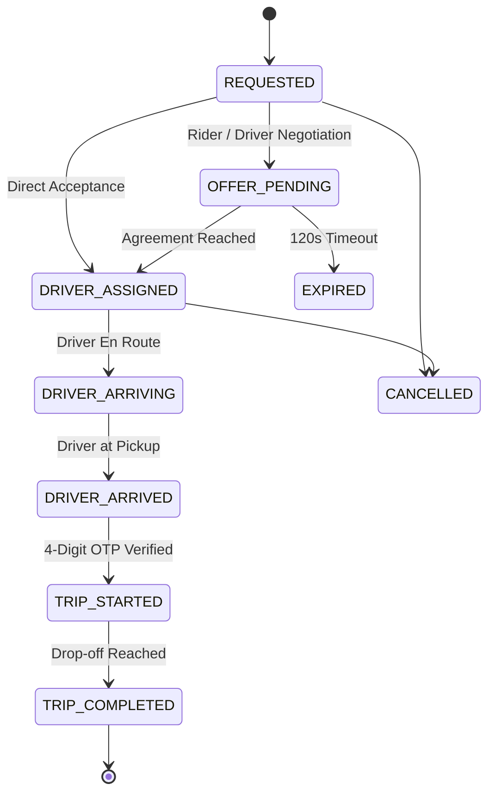

# GETRYDE Architecture Specification

## 1. System Overview
**GETRYDE** ("Your Ride. Your Choice. Your Way.") is a full-stack, real-time mobility and ride-booking platform engineered as a modular monorepo. It reimagines urban transport with smart fare negotiation, shared corridor pooling, driver earnings transparency, and AI-assisted conversational dispatch.

## 2. Monorepo Topology
```
GETRYDE/
├── apps/
│   ├── web/          # Next.js 15+ App Router, Tailwind CSS, Leaflet Maps, Zustand, Socket.IO Client
│   └── api/          # NestJS REST & WebSocket API, Prisma ORM, Razorpay, Swagger, Auth Guards
├── packages/
│   └── shared/       # Shared TypeScript enums, state machine transitions, DTO schemas, constants
├── prisma/
│   ├── schema.prisma # PostGIS-enabled PostgreSQL schema (30+ relational models)
│   └── seed.ts       # Database seeding script for initial pricing & test credentials
└── docs/             # Technical architecture, API, database, and security manuals
```

## 3. Technology Stack Justification
- **Frontend (Next.js 15 + App Router)**: Provides high-performance server/client hybrid rendering, dynamic route segments for Rider, Driver, and Admin portals, and real-time Leaflet OpenStreetMap integration.
- **Backend (NestJS)**: Enterprise-grade modular architecture featuring dependency injection, class-validator DTOs, Swagger documentation, and integrated Socket.IO gateways.
- **Database (PostgreSQL + PostGIS + Prisma)**: PostGIS spatial indices allow ultra-fast radial driver queries and corridor overlap calculations for smart ride pooling.
- **Cache & Real-Time (Redis + Socket.IO)**: Low-latency driver coordinate broadcasting and temporary negotiation session locks.
- **Payments (Razorpay)**: Secure Indian payments gateway supporting UPI, RuPay, cards, net banking, and instant automated refunds.

## 4. State Machine & Event Lifecycle

